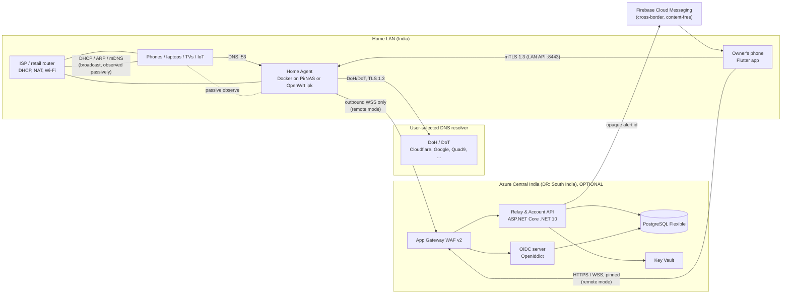
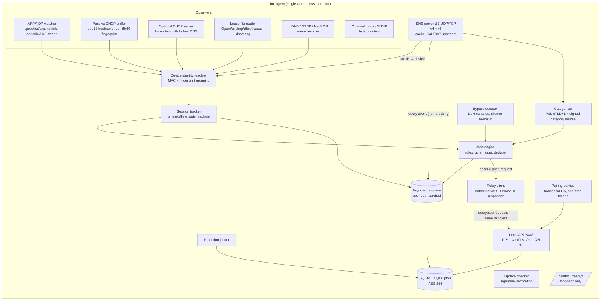
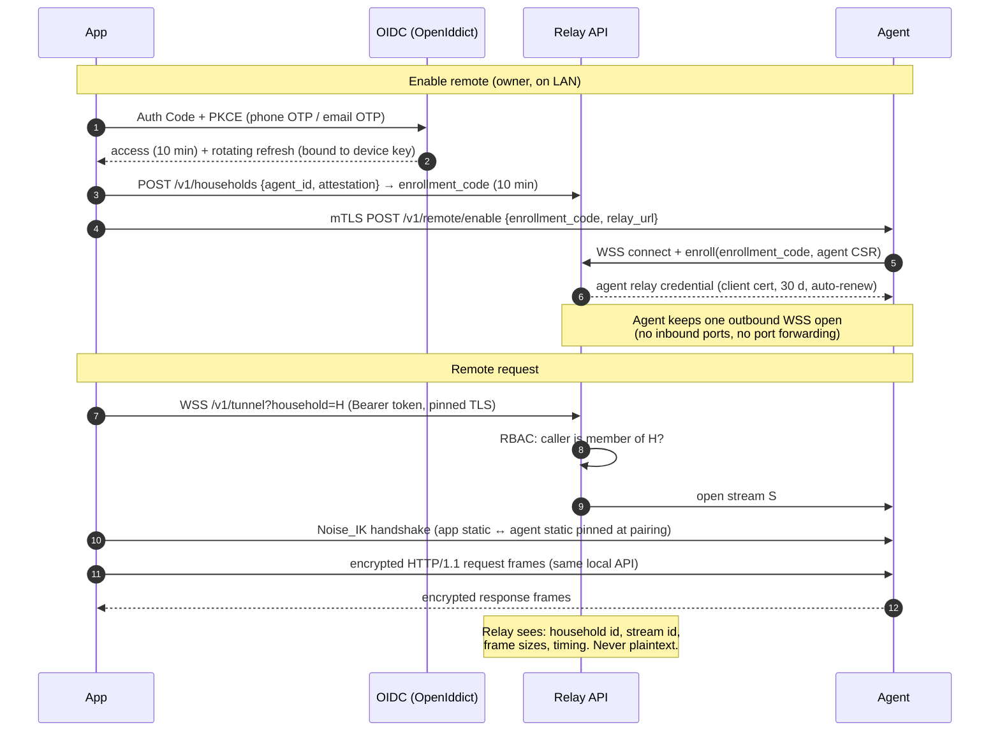
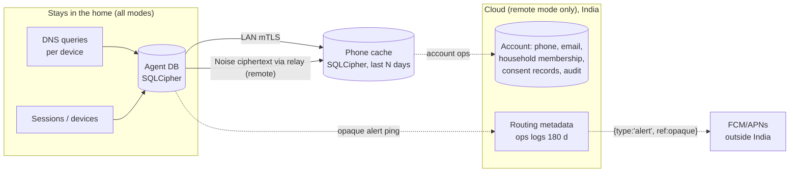

# Home Network Tracker: Architecture

| | |
|---|---|
| Status | **Accepted** (2026-11-21) |
| Version | 0.1.0 |
| Date | 2026-11-21 |
| Scope | MVP (see product brief) |
| Related | [Threat model](../security/threat-model.md), [ADRs](../adr/README.md), [Data model](data-model.md), [API contracts](../../api/README.md) |

---

## 1. Goals and non-goals

### 1.1 Goals
1. A household owner can see every device on the home LAN, when each device was online, and which **domains** each device looked up.
2. **Local-only by default.** With remote mode off, no personal data leaves the home and no cloud account is needed.
3. Remote access is optional and **end-to-end encrypted**. The cloud relay only ever handles ciphertext and routing metadata.
4. The product works with the routers Indian ISPs actually ship (JioFiber, Airtel Xstream, BSNL, ACT, Hathway, plus retail TP-Link, D-Link and Tenda), including routers that **do not let you change the DNS server** (see [ADR-0004](../adr/0004-dns-capture-strategy.md)).
5. It meets DPDP Act 2023 and DPDP Rules 2025, CERT-In Directions (April 2022), OWASP MASVS L2 for the app and ASVS L2 for the backend.

### 1.2 Non-goals (MVP)
Blocking and parental-control rules (we only design the hooks), per-app traffic volume, DPI, TLS interception, on-device VPN capture, payments.

### 1.3 What is technically possible (and what isn't)
A phone app cannot see other devices' traffic. All observation happens in the **Home Agent**, which becomes the LAN's DNS resolver and watches the L2 broadcast domain. Because of that:
- We see **domains** (for example `youtube.com`), never full URLs, page contents or search terms. HTTPS hides those.
- Devices that use hard-coded DoH/DoT, VPNs, iCloud Private Relay, Chrome/Firefox "secure DNS" with a custom provider, or the ISP's IPv6 DNS learned through router advertisements **bypass the agent**. We detect and flag some of these cases, but we cannot detect all of them ([§9](#9-known-limitations)).

---

## 2. System context



### 2.1 Components

| Component | Tech | Runs where | Responsibility |
|---|---|---|---|
| **Home Agent** (`/agent`) | Go, single static binary ([ADR-0003](../adr/0003-agent-language-go.md)) | Docker (linux/arm64, linux/amd64, linux/arm/v7) on Raspberry Pi, mini-PC or NAS; OpenWrt ipk (aarch64, arm, mipsel; ≥128 MB RAM) | Discovery, DNS resolver and logger, sessions, categorisation, alerts, local API, pairing, E2E tunnel endpoint, optional DHCP server |
| **Flutter App** (`/app`) | Flutter stable, Riverpod, go_router, dio, drift + SQLCipher | Android 8+ (minSdk 26), iOS 15+ | Pairing, dashboards, devices, timelines, sites, alerts, settings, consent, export and delete |
| **Relay & Account API** (`/backend`) | ASP.NET Core on .NET 10 LTS ([ADR-0009](../adr/0009-backend-dotnet10.md)) | Azure Container Apps, Central India | Accounts, OIDC, household membership and RBAC, agent enrollment, **blind** WSS relay, push fan-out, audit, consent records |
| **Infra** (`/infra`) | Bicep ([ADR-0015](../adr/0015-cloud-hosting-localization.md)) | Azure | Networking, WAF, Container Apps, PostgreSQL, Key Vault, Log Analytics |

---

## 3. Home Agent internals



### 3.1 DNS hot path (latency budget: p95 overhead < 5 ms)
1. A UDP/TCP packet arrives. The source IP is mapped to a `device_id` through an in-memory LRU fed by the ARP/NDP table. This is O(1) and never touches the DB.
2. The cache is checked (respecting TTLs, with up to 10 000 entries by default). On a hit we answer straight away.
3. On a miss, the query goes to the upstream DoH (HTTP/2, pooled connections) or DoT. Two upstreams race after a hedging delay of 50 ms.
4. The answer goes back to the client **first**. Then a `QueryEvent` is pushed onto a bounded channel. If the channel is full, the event is counted as dropped and the DNS path is never blocked.
5. A writer goroutine batches events (every 500 ms or 256 rows) into one SQLCipher transaction.
6. Optional DoH blocklist: queries for known DoH endpoints get `NXDOMAIN` and raise a `bypass_attempt` signal. This is **opt-in**.

"Overhead" means the agent's processing time with upstream RTT excluded. It is measured with an in-process histogram and with a `dnsperf` load test (30+ simulated devices, a 200 QPS burst) in CI.

### 3.2 Device identity and MAC randomisation ([ADR-0005](../adr/0005-device-identity.md))
- The primary key is `device_id` (a UUID). A device has one or more **identifiers** (MAC, DHCP client-id, hostname and fingerprint hash).
- Randomised MACs (locally administered bit set) are grouped with an existing device when the DHCP client-id, hostname **and** option-55 fingerprint all match. Otherwise a new device is created and flagged `possibly_randomized`.
- The user can **merge** devices (and undo a merge for 7 days). A merge re-points sessions and queries in one transaction.

### 3.3 Session tracking
This is a state machine per device: `unknown → online → offline`. A device goes online on any ARP/NDP reachability, DHCP, DNS or mDNS activity. It goes offline after `offline_grace` (default 5 min) with no activity **and** a failed active ARP probe. Sessions are closed with `disconnected_at`. Phones in Wi-Fi doze can flap, so gaps shorter than the grace period are merged.

### 3.4 Capture modes ([ADR-0004](../adr/0004-dns-capture-strategy.md))

| Mode | When | How devices find the agent | Device metadata source |
|---|---|---|---|
| **A. Router DNS** | Router lets you set the LAN DHCP DNS (TP-Link, D-Link, Tenda, most ACT and Hathway units) | Router DHCP hands out the agent IP as DNS | Passive DHCP sniffing, ARP, mDNS |
| **B. Agent DHCP** | Router DNS is locked (common on JioFiber and Airtel Xstream ISP firmware) | Router DHCP is disabled and the agent runs DHCPv4 | Authoritative (own leases) |
| **C. OpenWrt native** | Agent installed on the router | dnsmasq forwards to the agent on 127.0.0.1:5353, or the agent replaces dnsmasq DNS | `/tmp/dhcp.leases` and ubus |

IPv6 note: in modes A and B, IPv6-capable devices may still use ISP DNS learned through RA/RDNSS. The setup guide tells the user to disable IPv6 LAN DNS advertisement where the router allows it. The agent flags devices that have IPv6 activity but no DNS queries ([§9](#9-known-limitations)).

### 3.5 Agent hardening summary
Distroless static image; non-root UID 65532; read-only root filesystem with `/data` as the only writable volume; `--network host` (needed for L2 observation) with only the `NET_BIND_SERVICE` and `NET_RAW` capabilities (`NET_ADMIN` only in DHCP-server mode); seccomp default profile; local API bound to LAN interfaces only and never port-forwarded; health endpoint on loopback; per-IP rate limits on the pairing and API endpoints; cosign-signed images and minisign-signed ipk and update manifests ([ADR-0017](../adr/0017-agent-release-update-signing.md)).

---

## 4. Trust model and pairing ([ADR-0007](../adr/0007-agent-app-trust-pairing.md))

### 4.1 Keys

| Key | Algorithm | Generated by | Stored | Purpose |
|---|---|---|---|---|
| Household CA | ECDSA P-256 | Agent, first boot | Agent `/data/keys` (encrypted with the DB key) | Issues agent server cert and app client certs |
| Agent TLS leaf | ECDSA P-256, 1 y, auto-rotated | Agent | Agent | LAN API server cert. **SPKI pinned** in the app |
| Agent Noise static | X25519 | Agent | Agent | Remote E2E tunnel responder identity |
| App client cert | ECDSA P-256, 1 y | App (CSR) and agent CA | App secure storage (Keystore/Keychain-wrapped) | mTLS client auth and device binding |
| App Noise static | X25519 | App | App secure storage | Remote E2E tunnel initiator identity |
| DB key | 256-bit random | Agent | TPM 2.0 if present, else `/data/keys/db.key` 0400 | SQLCipher |

### 4.2 Pairing sequence (first owner)

```mermaid
sequenceDiagram
  autonumber
  actor O as Owner
  participant CLI as Agent console<br/>(docker exec / LuCI)
  participant AG as Home Agent
  participant APP as Flutter App

  Note over AG: First boot: generate household CA,<br/>TLS leaf, Noise static, DB key
  O->>CLI: hnt-agent pair  (or LuCI → Pair, needs router admin login)
  CLI->>AG: create pairing token (role=owner)
  AG-->>CLI: QR {v, agent_id, lan_addrs[], port,<br/>spki_sha256, noise_pub, token(128-bit), exp=now+5m}
  Note over CLI: QR shown ONLY on the admin console;<br/>no unauthenticated LAN web page
  O->>APP: Scan QR
  APP->>APP: Generate P-256 keypair + CSR,<br/>X25519 Noise keypair
  APP->>AG: TLS 1.3 connect, verify SPKI == spki_sha256 (pin)
  APP->>AG: POST /v1/pair {token_id, csr, noise_pub, device_info,<br/>proof = HMAC-SHA256(token, csr‖noise_pub‖tls_exporter)}
  AG->>AG: Check token unexpired and unused, check proof,<br/>rate limit (5 tries/token, 20/h/IP), bind to TLS channel
  AG->>AG: Sign client cert (CN=app_device_id, OU=role),<br/>store paired device, burn token, audit log
  AG-->>APP: {client_cert, ca_cert, household_id, agent_noise_pub}
  APP->>APP: Store cert/keys in secure storage, pin CA + SPKI
  APP->>AG: mTLS GET /v1/me  (proves client cert works)
  AG-->>APP: {role: owner}
  APP->>O: Consent & monitoring disclosure flow (DPDP)
```

The channel binding uses an RFC 9266-style TLS exporter in the HMAC proof. This stops a LAN attacker who sees the QR from relaying the token through a different TLS session. The token is single-use and expires in 5 minutes.

**Adding members and viewers:** the owner taps *Invite* in the app. The agent issues a token with `role=member|viewer`, and the owner's app shows the QR. The invitee scans it on the LAN, or remotely through the relay. Remote pairing is still safe because the SPKI and Noise key come from the QR, not from the relay.

**Revocation:** the owner removes a paired device. Its cert serial goes onto the agent's deny list, which is checked on every handshake, and the relay drops its routes.

### 4.3 Remote mode ([ADR-0008](../adr/0008-remote-relay-e2e.md))



The remote transport runs **the same OpenAPI local API** inside the Noise channel, so there is one handler code path. The app's `AgentTransport` abstraction picks the LAN (mTLS) or relay (Noise) transport.

---

## 5. Data flows



| Data | Where | Encrypted | Retention | Leaves India? |
|---|---|---|---|---|
| DNS queries, sessions, device inventory | Agent | SQLCipher AES-256 | DNS and sessions: user-set 7/30/90 d (default 30). Devices: until deleted, or 90 d after last seen if untrusted | No (the upstream resolver sees queries; see below) |
| Same, cached | Phone | SQLCipher, key in Keystore/Keychain | `min(agent retention, 7 d)` by default | No |
| Account (phone, email), membership | Backend PostgreSQL | TDE + TLS, Key Vault CMK | Until account deletion + 30 d recovery window, then purged | No |
| Consent records | Backend (remote) and agent (all modes) | yes | Life of account + 1 y (DPDP Rules log retention; to be confirmed with counsel) | No |
| Audit logs | Backend and agent | yes | 1 y | No |
| Backend operational logs | Log Analytics, Central India | yes | 180 d (CERT-In) | No |
| Push token + opaque alert id | FCM (Google) | TLS | Transient | **Yes**, documented as cross-border processing |
| DNS lookups to the upstream resolver | Resolver chosen by the user | DoH/DoT | Resolver's policy | Depends on the resolver's anycast. This is disclosed at selection |

---

## 6. Flutter app architecture ([ADR-0011](../adr/0011-flutter-state-routing-architecture.md), [ADR-0012](../adr/0012-flutter-local-storage.md))

```
app/lib/
  main_dev.dart | main_staging.dart | main_prod.dart
  bootstrap.dart                    # zone, error handling, flavor config, ProviderScope
  core/
    config/        flavor config (from --dart-define-from-file, no secrets)
    network/       AgentTransport (LanMtls | RelayNoise), dio + interceptors (auth, retry, redacting logger)
    security/      pinning, secure storage, biometric lock, integrity, root detection, FLAG_SECURE
    storage/       drift database (SQLCipher), key management
    l10n/          ARB: en, hi, te, ta
    routing/       go_router config, guards (paired? consented? locked?)
    ui/            theme (M3, dark), design tokens, state widgets (Loading/Empty/Error/Offline)
  features/
    onboarding/   consent/   pairing/   router_setup/
    dashboard/    devices/   sessions/  sites/   alerts/
    profiles/     settings/  account/   help/
      each: presentation/ (screens, widgets, controllers)
            domain/       (entities, repositories (abstract), use cases)
            data/         (DTOs (freezed), remote + local data sources, repo impl)
```

- **Offline-first:** repositories return a `Stream` from drift. A sync controller pulls deltas (`?since=cursor`) from the agent whenever it is reachable. The UI shows `last synced` and an offline banner. Writes such as rename go into an outbox and are replayed with idempotency keys.
- **Every screen** uses the shared `AsyncStateView` (loading, empty, error with retry, and offline with cached data).
- **Generated client:** the Dart client for the agent and cloud APIs is generated from OpenAPI 3.1 (`openapi-generator` `dart-dio` with freezed-compatible models) into `app/packages/hnt_api/`.
- **Size and performance:** per-ABI split APKs/AAB, `--obfuscate --split-debug-info`, deferred loading for router guide images (WebP, downloaded on demand and cached), paginated lists (cursor, 50/page), and an isolate for CSV/JSON export.

---

## 7. Backend (remote mode only)

Minimal surface:
- `IDP`: OpenIddict authorization server. Supports Authorization Code + PKCE only, phone OTP (through a DLT-registered Indian SMS gateway) and email OTP, 10-min access tokens, rotating refresh tokens with reuse detection, and refresh bound to the app's device key (DPoP, RFC 9449).
- `Accounts`: profile, DPDP rights (access, correct, erase), grievance tickets, consent records.
- `Households`: membership and RBAC (`owner`, `member`, `viewer`), agent enrollment and revocation.
- `Relay`: WSS endpoints for agents and apps. Stream multiplexing, per-household RBAC check at stream open, frame-size and rate limits. **No payload persistence.**
- `Push`: agent sends `{household, alert_ref}`; backend fans out to the registered FCM tokens of members subscribed to alerts. The payload contains no names, domains or device info.
- `Audit`: append-only table (and Log Analytics) for security-relevant events.
- Play Integrity and App Attest are verified at account registration and token refresh. Failure → risk flag and step-up (OTP), not a hard block.

---

## 8. Cross-cutting

| Concern | Decision |
|---|---|
| Transport | TLS 1.3 only, everywhere (agent API, relay, IDP, DoH upstream where the resolver supports it; DoT fallback for resolvers without TLS 1.3 is refused) |
| Pinning | App pins the agent SPKI (from pairing) and the backend intermediate CA SPKI plus a backup pin, with pins rotated through app releases |
| Time | Agent: `systemd-timesyncd`/`ntpd` against `time.nplindia.org` / `samay1.nic.in`, flagged if skew > 2 s. Backend: Azure NTP, with CERT-In ICT clock sync documented |
| Observability | Agent: structured JSON logs (no domains or MACs at INFO), `/metrics` (loopback, Prometheus). App: Sentry (self-hosted option) or Crashlytics with a PII scrubber, **opt-in** analytics. Backend: OpenTelemetry → Log Analytics |
| Feature flags | `alerts.enabled`, `alerts.adult`, `remote.enabled`, `doh_block.enabled`, `dhcp_server.enabled`. Agent flags are local config. App flags come from flavor config, overridden remotely only in remote mode |
| Blocking hooks | `PolicyEngine` interface in the agent DNS pipeline (`Decide(ctx, device, qname) → Allow`), a no-op in the MVP. `profile.schedule` already modelled |
| Versioning | SemVer per component, `CHANGELOG.md` (Keep a Changelog), API version in path (`/v1`) |

---

## 9. Known limitations

These will also be shown in the app's Help screen and the README:
1. **Only domain names are visible.** We cannot see full web addresses, pages, searches, messages or videos watched. For example, we see `youtube.com` but not which video.
2. **Encrypted DNS and VPNs hide activity.** A device that uses its own encrypted DNS (DoH/DoT), a VPN, iCloud Private Relay or a proxy will show little or no site activity. We show a "possible DNS bypass" warning when we notice signs of this, but we cannot catch every case.
3. **IPv6 DNS.** Some ISP routers (often JioFiber) advertise their own IPv6 DNS servers. Devices that use them bypass the agent unless the router's IPv6 DNS setting is changed or IPv6 LAN DNS advertisement is disabled.
4. **Domain counts are not time spent.** One page can trigger dozens of lookups, and apps look up domains in the background. Counts show activity, not browsing duration or intent.
5. **Device names and types are best guesses.** They come from vendor prefixes and network hints. Phones that use private/random Wi-Fi addresses may appear as several devices, and you can merge them.
6. **Agent must be online.** If the agent or the device it runs on is off, nothing is recorded. If you made the agent the DNS server and it goes down, devices may lose internet. The setup guide explains how to configure a secondary DNS server, which reduces coverage.
7. **Categories can be wrong.** Domain categories come from public lists and can be outdated or incomplete. "Unknown" is common.
8. **Local-only mode has no instant push alerts.** Alerts appear when the app checks in on home Wi-Fi (on Android roughly every 15 minutes in the background, on iOS when you open the app). Remote mode enables push.
9. **Not for covert monitoring.** You must inform household members that network activity is logged.

---

## 10. Assumptions and flagged conflicts

| # | Topic | Decision (safer option) | Needs your confirmation |
|---|---|---|---|
| A1 | **.NET 9 is out of support** (STS ended May 2026) | Use **.NET 10 LTS** ([ADR-0009](../adr/0009-backend-dotnet10.md)) | ✔ |
| A2 | **Account creation for local-only users.** The brief makes OTP sign-up mandatory, but local-only mode sends nothing to the cloud | Account **optional** in local-only mode and required only to enable remote access or push (data minimisation, DPDP §6). The onboarding step is kept but can be skipped ([ADR-0010](../adr/0010-identity-oidc-otp.md)) | ✔ |
| A3 | **Locked DNS on ISP routers** (JioFiber, Airtel) | Add an **optional agent DHCP server mode**. This is a small scope addition without which a large share of Indian homes can't use the product ([ADR-0004](../adr/0004-dns-capture-strategy.md)) | ✔ |
| A4 | **Azure Front Door** terminates TLS at global edge PoPs, some outside India | Use **regional App Gateway WAF v2** in Central India instead ([ADR-0015](../adr/0015-cloud-hosting-localization.md)) | |
| A5 | **Azure AD B2C** is closed to new customers. Entra External ID data residency for India is not guaranteed | Self-hosted **OpenIddict** in Central India | |
| A6 | **SMS OTP in India** requires TRAI DLT registration (entity, header, template) | Use a DLT-registered Indian gateway (for example MSG91 or Gupshup), with registration as a launch prerequisite | Pick provider |
| A7 | **mTLS client key on mobile** cannot be hardware-non-exportable, because Dart's TLS stack (BoringSSL) needs the raw key | Key generated in-app and stored encrypted with a Keystore/Keychain-held key, loaded into memory only for handshakes, 1-year certs, instant revocation. This is documented as residual risk | |
| A8 | **Agent auto-update in Docker.** Self-replacing a container needs the Docker socket, which is effectively root | Docker: **notify + one-command signed update** by default, with an opt-in updater sidecar that runs `cosign verify` first. OpenWrt/binary: signed in-place auto-update ([ADR-0017](../adr/0017-agent-release-update-signing.md)) | ✔ |
| A9 | **Agent DB key** on a Pi without a TPM sits on the same disk | TPM 2.0 when present, otherwise a file key. At-rest encryption mainly protects against casual SD-card or backup exposure, and this is stated plainly | |
| A10 | **DPDP §9(3)**: no "tracking or behavioural monitoring of children" by a Data Fiduciary | We (the company) never access DNS content (E2E, local-first), run no analytics or ads on it, and the owner's household processing falls under §3(c)(i) personal/domestic use. Owner must be 18+, with parental consent records kept for minor profiles. **Legal review required before launch** | Counsel |
| A11 | **Category list licensing** (UT1 is CC BY-SA, URLhaus is CC0, DoH lists vary) | Ship only lists whose licence allows redistribution, with attribution in the app, signed bundle | |
| A12 | **CERT-In 5-year subscriber records** apply to VPN, VPS, cloud and DC providers | Not applicable: we are not a DNS or VPN service provider (the resolver is the household's own device). We keep 180-day ops logs and the 6-hour incident reporting runbook | Counsel |
| A13 | **Grievance officer and DPO details** | Shown in the app from signed remote config or the build config. Docs use `[to be appointed]` until named | Name/contact |
| A14 | **Low-end OpenWrt routers** (≤64 MB RAM, ≤16 MB flash) cannot fit the agent | OpenWrt ipk supports ≥128 MB RAM and ≥32 MB flash, or extroot | |
| A15 | **Toolchain versions** | Flutter: latest stable pinned through FVM. Go: latest stable (≥1.26) pinned in `go.mod` toolchain. .NET 10 LTS | |

---

## 11. Delivery plan (after approval)

| Step | Deliverable |
|---|---|
| 2 | Data model (all 10 entities), indexes, retention rules: `docs/architecture/data-model.md` + agent migrations + backend EF migrations |
| 3 | `api/agent.openapi.yaml`, `api/cloud.openapi.yaml` (3.1), Spectral lint, generated Dart client |
| 4 | Agent (Go): discovery, DNS, sessions, categoriser, alerts, local API, pairing, Noise tunnel, DHCP mode, Dockerfile, OpenWrt Makefile |
| 5 | Flutter app: all MVP features, 4 locales, flavors |
| 6 | Backend relay (.NET 10) |
| 7 | Tests (unit, widget, golden, integration, contract, dnsperf load), GitHub Actions, Bicep |
| 8 | Docs: README, ISP router guides, SECURITY.md, privacy policy, DPDP consent text (en/hi/te/ta), runbooks, Data Safety / privacy labels |
| 9 | Known limitations: README + in-app Help |
