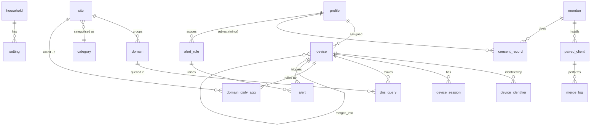

# Data Model

| | |
|---|---|
| Status | Accepted with architecture v0.1.0 |
| Agent DDL (source of truth) | [`agent/internal/store/migrations/0001_init.sql`](../../agent/internal/store/migrations/0001_init.sql) |
| Backend DDL (logical) | [§4](#4-backend-schema-postgresql-remote-mode-only) below. EF Core migrations generated in deliverable 6 must match it |
| API representations | [`api/agent.openapi.yaml`](../../api/agent.openapi.yaml), [`api/cloud.openapi.yaml`](../../api/cloud.openapi.yaml) |

## 1. Where each entity lives

The core privacy property ([ADR-0002](../adr/0002-three-tier-local-first.md)) is that **browsing and presence data exist only on the agent and in the paired phones' caches.** The backend holds only account, membership and routing data.

| Entity | Agent (SQLite/SQLCipher) | Backend (PostgreSQL, India) | Phone cache (drift/SQLCipher) |
|---|---|---|---|
| **Household** | `household` (1 row) + `setting` | `households` (id, remote flag only) | current household |
| **User** | `member` + `paired_client` (app installs, certs) | `users` + `household_members` + `app_devices` | own identity |
| **Agent** | `household.agent_uid` | `agents` + `agent_enrollments` | agent endpoint + pins |
| **Device** | `device` + `device_identifier` + `merge_log` | ✘ never | ✔ |
| **DeviceSession** | `device_session` | ✘ never | ✔ (≤ 7 d) |
| **DnsQuery** | `dns_query` + `domain` + `domain_daily_agg` | ✘ never | aggregates only (≤ 7 d). Raw rows fetched on demand, not stored |
| **DomainCategory** | `category` + `site` (eTLD+1 → category, source) | ✘ (bundles are public, signed files on CDN) | `site` subset |
| **Alert** | `alert_rule` + `alert` | ✘ only transient `{alert_ref}` for push fan-out, not persisted | ✔ |
| **ConsentRecord** | `consent_record` (all modes) | `consent_records` (remote mode / account holders) | – |
| **AuditLog** | `audit_log` (hash-chained) | `audit_logs` (append-only, partitioned) | – |

## 2. Entity-relationship diagram (agent)



## 3. Agent entities

Conventions: `INTEGER` rowids for joins, public `uid` = UUIDv7 text, timestamps in UTC epoch ms, and `rev` = global monotonic change counter for delta sync (`GET /v1/sync/changes?since=`). Deleted rows leave a `tombstone`.

### 3.1 Household and settings
`household` has exactly one row, holding `retention_days ∈ {7,30,90}` (default 30), `max_db_mb` (default 1024, 256 on OpenWrt), `timezone` (default `Asia/Kolkata`), the remote-mode flag and `monitoring_ack_ms`.

`setting` holds typed JSON values:

| Key | Shape (validated against the OpenAPI `Settings` schema) |
|---|---|
| `dns.upstream` | `{preset: cloudflare\|google\|quad9\|adguard\|custom, protocol: doh\|dot, url?, bootstrap_ips[]}` |
| `dns.doh_block` | `{enabled: false, block_icloud_relay: false}` |
| `capture.mode` | `router_dns \| agent_dhcp \| openwrt` |
| `dhcp.server` | `{enabled, range_start, range_end, lease_hours, gateway, static_leases[]}` |
| `alerts` | `{enabled, quiet_hours?}` |
| `features` | `{remote_enabled, alerts_enabled, doh_block_enabled, dhcp_server_enabled}` |

### 3.2 User (member, paired_client)
- `member`: a person in the household with a role (`owner`/`member`/`viewer`). A partial unique index allows **one active owner**. `cloud_user_id` links the member to a backend account in remote mode.
- `paired_client`: one row per paired app install. It holds the cert serial, SPKI hash, Noise public key and revocation. Authorisation always reads role from `member`, never from cert fields alone.
- `pairing_token`: stores only a hash of the secret. A CHECK constraint enforces a lifetime of ≤ 5 min, with at most 5 attempts per token.

### 3.3 Device
| Column | Notes |
|---|---|
| `display_name` / `auto_name` | The user's rename wins. `auto_name` comes from mDNS > DHCP hostname > vendor + type |
| `vendor`, `device_type`, `type_source` | OUI lookup and heuristics. A user override sets `type_source='user'` so heuristics stop changing it |
| `profile_id`, `trusted` | Assignment to a family member. `trusted` suppresses "unknown device" alerts |
| `possibly_randomized` | Locally-administered MAC bit set and no strong match ([ADR-0005](../adr/0005-device-identity.md)) |
| `bypass_suspected_ms` | Set by the bypass detector and shown as a badge |
| `merged_into` | Soft-merge for the 7-day undo window, then hard-deleted |

`device_identifier(kind, value)` is globally unique, so an identifier belongs to exactly one device. Merging moves identifier rows and re-points `dns_query`/`device_session`/`domain_daily_agg` in one transaction. `merge_log.moved_ids_json` makes the undo exact.

Masking: MACs are stored in clear inside the encrypted DB. They are masked by the **API** unless the caller requests `reveal=true` with role `owner`, and every reveal is audited.

### 3.4 DeviceSession
- `connected_ms`, `disconnected_ms` (NULL means online), `ipv4`, `close_reason`.
- A partial unique index guarantees **one open session per device**.
- Duration is computed (`disconnected_ms − connected_ms`) and never stored.
- Gaps shorter than `offline_grace` (5 min) are merged by the tracker, not written as new sessions.

### 3.5 DnsQuery
Write-optimised design for low-end hardware:
- **Dictionary encoding:** `domain(name → site_id)` and `site(etld1)` store each name once. A `dns_query` row is about 40–60 bytes.
- **Coalescing:** repeats of `(device, domain, qtype)` within 60 s update `last_ts_ms`/`repeat_count` instead of inserting new rows. Apps and OSes re-query aggressively, so this typically cuts rows by 60–80%.
- `flags` bitfield: cached, blocked (future policy hook), DoH canary hit, arrived over IPv6, arrived over DoT.
- `answer`: up to two addresses or a CNAME target (the "response" requirement), truncated.
- No FK constraints on this hot table. The janitor removes orphans after merges and deletions.

`domain_daily_agg(day, device_id, site_id)` is maintained by the writer in the same transaction as the inserts. It serves the dashboard ("top domains today") and the Sites lists without scanning raw rows.

**Sizing (30 devices, after coalescing):** about 60k rows/day ≈ 6 MB/day including indexes. That is ≈ 180 MB at 30 days and ≈ 540 MB at 90 days. `max_db_mb` enforces a hard cap by pruning the oldest raw queries first; aggregates are kept. OpenWrt defaults to 7 days / 256 MB.

### 3.6 DomainCategory
- `category`: a fixed taxonomy seeded by the migration (`social, video, gaming, adult, shopping, education, news, malicious, infrastructure, unknown`). `sensitive` and `alertable` drive alert rules. `infrastructure` is hidden in Sites views by default.
- `site.category` + `category_source` (`bundle` or `user`) + `bundle_version`. A user override (owner only) survives bundle updates. When a new bundle arrives, all `source='bundle'` rows are re-evaluated lazily on next access.

### 3.7 Alert
- `alert_rule(kind, profile_id?, params_json)`. Kinds and params:
  - `new_device` `{}`
  - `outside_hours` `{}` (uses `profile.schedule_json`)
  - `category_access` `{categories:["adult","malicious"]}`
  - `dns_bypass` `{}`
- `alert.uid` is an opaque 128-bit random value. It is the **only** value that leaves the home in a push.
- `dedupe_key` (for example `category_access:<device>:<category>:<hour>`) plus an index enforces at most one alert per key per window.

### 3.8 ConsentRecord
- One row per decision (grant or withdrawal). A record is never updated except to set `withdrawn_ms`.
- `evidence_sha256` is the hash of the exact localised notice text shown, and `notice_version` + `language` make the record reproducible.
- `minor_parental_consent` **must** reference a minor `profile` (CHECK constraint).

### 3.9 AuditLog
- Append-only, enforced by triggers. `UPDATE` always aborts, and `DELETE` aborts for rows younger than 365 days.
- Hash chain: `hash = SHA-256(prev_hash ‖ ts_ms ‖ actor ‖ action ‖ target_type ‖ target_uid ‖ details_json)`, with the genesis `prev_hash` set to 32 zero bytes. `GET /v1/audit/verify` recomputes the chain.
- `details_json` must never contain domains, MACs or IPs. This is enforced by the Go `audit.Details` type allow-list.
- **Factory reset** (`POST /v1/data/erase {scope: everything}`) deletes the DB file and DB key (crypto-shredding), so the triggers do not block it.

### 3.10 Index rationale (agent)

| Index | Serves |
|---|---|
| `ix_dnsq_device_time (device_id, ts_ms DESC)` | Per-device query list, paginated by `(ts_ms, id)` keyset |
| `ix_dnsq_domain_time (domain_id, ts_ms DESC)` | "Who visited X" drill-down |
| `ix_dnsq_time (ts_ms)` | Retention janitor range deletes |
| `domain_daily_agg` PK + `ix_agg_site_day` + `ix_agg_device_day` | Dashboard top sites, household and per-device Sites views |
| `ix_session_device_time`, `ux_session_one_open` | Timeline and "online now" |
| `ix_device_last_seen`, `ix_device_first_seen` (partial, unmerged) | Device list sort, "new this week" |
| `ix_*_rev` | Delta sync |
| `ix_alert_unread` (partial) | Badge count |

## 4. Backend schema (PostgreSQL, remote mode only)

Region: Azure Central India, geo-backup to South India. TDE uses a customer-managed key in Key Vault. PII columns are encrypted at the application layer with a Key Vault-wrapped data key (AES-256-GCM). Lookups use HMAC-SHA256 "blind index" columns.

```sql
CREATE TABLE users (
  id                 uuid PRIMARY KEY,
  phone_hmac         bytea  NOT NULL UNIQUE,         -- HMAC(E.164) for lookup
  phone_enc          bytea  NOT NULL,                -- AES-GCM(E.164)
  email_hmac         bytea  UNIQUE,
  email_enc          bytea,
  phone_verified_at  timestamptz,
  email_verified_at  timestamptz,
  age_18_declared_at timestamptz NOT NULL,
  locale             text   NOT NULL DEFAULT 'en' CHECK (locale IN ('en','hi','te','ta')),
  status             text   NOT NULL DEFAULT 'active' CHECK (status IN ('active','pending_erasure','locked')),
  erasure_due_at     timestamptz,                    -- set on DELETE /v1/me (+30 d)
  created_at         timestamptz NOT NULL DEFAULT now(),
  updated_at         timestamptz NOT NULL DEFAULT now()
);

CREATE TABLE households (
  id              uuid PRIMARY KEY,                  -- = agent-side household.uid
  remote_enabled  boolean NOT NULL DEFAULT true,
  created_at      timestamptz NOT NULL DEFAULT now(),
  disabled_at     timestamptz
);

CREATE TABLE household_members (
  household_id  uuid NOT NULL REFERENCES households(id) ON DELETE CASCADE,
  user_id       uuid NOT NULL REFERENCES users(id) ON DELETE CASCADE,
  role          text NOT NULL CHECK (role IN ('owner','member','viewer')),
  invited_by    uuid REFERENCES users(id) ON DELETE SET NULL,
  created_at    timestamptz NOT NULL DEFAULT now(),
  PRIMARY KEY (household_id, user_id)
);
CREATE UNIQUE INDEX ux_one_owner ON household_members(household_id) WHERE role = 'owner';
CREATE INDEX ix_members_user ON household_members(user_id);

CREATE TABLE household_invitations (
  code_hash     bytea PRIMARY KEY,                   -- SHA-256 of 128-bit code
  household_id  uuid  NOT NULL REFERENCES households(id) ON DELETE CASCADE,
  role          text  NOT NULL CHECK (role IN ('member','viewer')),
  created_by    uuid  NOT NULL REFERENCES users(id) ON DELETE CASCADE,
  expires_at    timestamptz NOT NULL,                -- ≤ 24 h
  accepted_by   uuid REFERENCES users(id) ON DELETE SET NULL,
  accepted_at   timestamptz
);

CREATE TABLE agents (
  id                uuid PRIMARY KEY,                -- = agent-side household.agent_uid
  household_id      uuid NOT NULL UNIQUE REFERENCES households(id) ON DELETE CASCADE,
  cert_serial       text NOT NULL UNIQUE,
  cert_not_after    timestamptz NOT NULL,
  version           text NOT NULL,
  arch              text NOT NULL,
  enrolled_at       timestamptz NOT NULL DEFAULT now(),
  last_connected_at timestamptz,
  revoked_at        timestamptz
);

CREATE TABLE agent_enrollments (
  code_hash     bytea PRIMARY KEY,
  household_id  uuid NOT NULL REFERENCES households(id) ON DELETE CASCADE,
  created_by    uuid NOT NULL REFERENCES users(id) ON DELETE CASCADE,
  expires_at    timestamptz NOT NULL,                -- 10 min
  used_at       timestamptz
);

CREATE TABLE app_devices (
  id                  uuid PRIMARY KEY,
  user_id             uuid NOT NULL REFERENCES users(id) ON DELETE CASCADE,
  platform            text NOT NULL CHECK (platform IN ('android','ios')),
  dpop_jkt            text NOT NULL UNIQUE,          -- RFC 7638 thumbprint of DPoP key
  push_token_enc      bytea,
  push_enabled        boolean NOT NULL DEFAULT false,
  attestation_status  text NOT NULL DEFAULT 'unverified'
                      CHECK (attestation_status IN ('unverified','passed','failed','unsupported')),
  attested_at         timestamptz,
  last_seen_at        timestamptz,
  revoked_at          timestamptz,
  created_at          timestamptz NOT NULL DEFAULT now()
);
CREATE INDEX ix_app_devices_user ON app_devices(user_id) WHERE revoked_at IS NULL;

CREATE TABLE consent_records (
  id              uuid PRIMARY KEY,
  user_id         uuid REFERENCES users(id) ON DELETE SET NULL,  -- kept after erasure (legal basis proof)
  subject_ref     text NOT NULL,                     -- user id or 'profile:<uid>' (no names)
  purpose         text NOT NULL,
  notice_version  text NOT NULL,
  language        text NOT NULL,
  granted         boolean NOT NULL,
  method          text NOT NULL,
  evidence_sha256 bytea NOT NULL,
  created_at      timestamptz NOT NULL DEFAULT now(),
  withdrawn_at    timestamptz
);
CREATE INDEX ix_consent_user ON consent_records(user_id, purpose, created_at DESC);

CREATE TABLE grievances (
  id            uuid PRIMARY KEY,
  user_id       uuid REFERENCES users(id) ON DELETE SET NULL,
  category      text NOT NULL CHECK (category IN ('access','correction','erasure','consent','breach','other')),
  description_enc bytea NOT NULL,
  status        text NOT NULL DEFAULT 'open' CHECK (status IN ('open','in_progress','resolved','rejected')),
  due_at        timestamptz NOT NULL,                -- SLA per DPDP Rules (counsel to confirm)
  created_at    timestamptz NOT NULL DEFAULT now(),
  resolved_at   timestamptz
);

CREATE TABLE audit_logs (
  id            bigserial,
  ts            timestamptz NOT NULL DEFAULT now(),
  actor_type    text NOT NULL CHECK (actor_type IN ('user','agent','system','admin')),
  actor_id      uuid,
  household_id  uuid,
  action        text NOT NULL,
  ip_hmac       bytea,                               -- keyed hash, never raw IP
  details       jsonb NOT NULL DEFAULT '{}',
  PRIMARY KEY (id, ts)
) PARTITION BY RANGE (ts);                           -- monthly partitions, drop after 12 months
CREATE INDEX ix_audit_household ON audit_logs(household_id, ts DESC);
CREATE INDEX ix_audit_actor ON audit_logs(actor_id, ts DESC);
-- App role has INSERT/SELECT only on audit_logs (no UPDATE/DELETE). The partition-drop job runs as a separate role.
```

OpenIddict's own tables (applications, authorizations, scopes, tokens) store only token metadata and hashed reference IDs. Refresh-token families are revoked on reuse.

## 5. Retention rules

| Data | Store | Rule | Mechanism |
|---|---|---|---|
| `dns_query` | Agent | `retention_days` (7/30/90, default 30) **and** `max_db_mb` cap | Hourly janitor, batched deletes of 5k rows on `ix_dnsq_time` |
| `domain_daily_agg` | Agent | `retention_days` | Daily janitor |
| `device_session` | Agent | closed sessions older than `retention_days`. Open sessions are never pruned | Hourly janitor |
| `device` (+ identifiers) | Agent | Kept while trusted, renamed or assigned. Otherwise deleted when `last_seen` is older than `retention_days` | Daily janitor → tombstone |
| `merge_log` | Agent | 7 days, then the merged device is hard-deleted | Daily |
| `alert` | Agent | `retention_days` | Daily |
| `site` / `domain` | Agent | Garbage-collected when unreferenced, unless they hold a user override | Weekly |
| `pairing_token` | Agent | Deleted 24 h after use or expiry | Hourly |
| `revoked_cert` | Agent | Deleted after cert `not_after` | Daily |
| `tombstone` | Agent | 30 days. Clients offline for longer do a full resync | Daily |
| `consent_record` | Agent | Life of the household. Destroyed only by factory reset | – |
| `audit_log` | Agent | 365 days (trigger-protected) | Daily |
| Phone cache | App | `min(retention_days, 7)` days. Raw queries not cached | On sync |
| `users` | Backend | Until erasure request + 30-day recovery window, then hard delete | Daily job |
| `household_*`, `agents` | Backend | Deleted when remote is disabled or the owner's account is erased | Immediate |
| `agent_enrollments`, `household_invitations` | Backend | 24 h after expiry or use | Hourly job |
| `app_devices` | Backend | Revoked + 30 d, or 180 d inactive | Daily |
| `consent_records` | Backend | Life of account + 1 year (DPDP Rules log retention, **counsel to confirm**). `user_id` nulled at erasure | Daily |
| `grievances` | Backend | Resolution + 1 year (counsel to confirm) | Daily |
| `audit_logs` | Backend | 12 months (monthly partition drop) | Monthly |
| Operational logs | Log Analytics | 180 days (CERT-In Directions 2022), no DNS or device content | Workspace retention |

Changing `retention_days` to a shorter value takes effect on the next janitor run (≤ 1 h). The app warns that older data will be deleted.

## 6. Hooks for future blocking (out of MVP scope)
- `profile.schedule_json` holds allowed hours, already used by `outside_hours` alerts.
- `dns_query.flags` bit1 (`blocked`) and the `PolicyEngine` interface in the DNS path.
- New tables (`policy_rule`) will be added in a later migration without changing existing ones.
