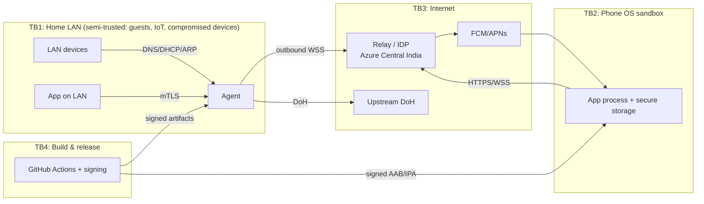

# Threat Model (STRIDE): Home Network Tracker

| | |
|---|---|
| Status | Proposed |
| Method | STRIDE per element on the data-flow diagram, with risk rated as Likelihood × Impact (L/M/H) |
| Review | At each minor release, and whenever a trust boundary changes |

## 1. Assets

| ID | Asset | Sensitivity |
|---|---|---|
| AS1 | Per-device DNS history (which domains were looked up, and when) | **High**: reveals health, religion, sexuality and political interests (sensitive personal data) |
| AS2 | Device inventory and presence timeline (who is home, and when) | High: physical safety (burglary, stalking) |
| AS3 | Household CA private key, agent TLS/Noise keys | Critical: impersonating the agent |
| AS4 | App client cert key, Noise static key, refresh tokens | High: impersonating a household member |
| AS5 | Account PII (phone, email), household membership | Medium |
| AS6 | Consent records and audit logs | Medium (integrity matters most) |
| AS7 | Agent update channel and signing keys | Critical: code execution on every agent |
| AS8 | DNS resolution availability | High: if the agent fails, the household loses internet |

## 2. Trust boundaries

**The LAN is not trusted.** Indian homes commonly have shared Wi-Fi passwords, guest devices and low-quality IoT devices. Every control assumes an attacker can be present on the LAN.

## 3. Threats and mitigations

### 3.1 Pairing flow

| STRIDE | Threat | Risk | Mitigation | Residual |
|---|---|---|---|---|
| S | A guest on the LAN pairs first and becomes owner | H | QR is shown only on the admin console (`docker exec`, SSH or LuCI behind router login). No unauthenticated pairing page. One-time 128-bit token, 5-min TTL | Low |
| S | MITM between app and agent during pairing (ARP spoofing) | M | App pins the agent SPKI hash from the QR, so a MITM cert fails | Low |
| T | Captured QR or token replayed through another TLS session | M | Proof = HMAC(token, CSR‖noise_pub‖TLS exporter). Token is bound to the TLS channel, single-use and burned on first valid use | Low |
| D | Pairing endpoint brute-forced or flooded | M | 5 attempts per token, 20/h per source IP, global token bucket. Tokens are 128-bit (not guessable) | Low |
| R | An owner denies adding a member | L | Agent audit log: pairing events with role, device info and inviter | Low |
| E | A member invite is escalated to owner | M | Role is fixed in the token server-side and encoded in the cert OU. The agent authorises on its stored role, not on the cert alone | Low |

### 3.2 Home Agent

| STRIDE | Threat | Risk | Mitigation | Residual |
|---|---|---|---|---|
| S | Spoofed ARP or DHCP makes one device look like another and pollutes the history | M | Identity grouping uses several signals. Device changes trigger alerts ("MAC seen with new fingerprint"). The UI explains that attribution is best-effort | Medium (inherent to L2) |
| S | Rogue DNS server on the LAN | M | Documented. The bypass detector flags devices with no queries to the agent. Out of scope to prevent | Medium |
| T | Tampering with DB or keys on SD card | M | SQLCipher AES-256, key in TPM when present. File perms 0400, UID 65532 | Medium without TPM (A9) |
| T | Malicious update | H | Images signed with cosign keyless (Sigstore, GitHub OIDC). ipk and updates signed with a minisign Ed25519 key kept in HSM-backed Key Vault. Agent verifies the signature **and** rejects version downgrades | Low |
| T | Category bundle poisoning | M | Bundles are signed with the same release key and have a monotonic version | Low |
| R | Unlogged admin actions (retention change, delete all) | M | Append-only audit table with a hash chain (each row has the SHA-256 of the previous one) | Low |
| I | Another LAN device reads DNS logs through the API | H | API is mTLS-only. No unauthenticated routes except `/v1/pair` (token required) and loopback `/healthz` | Low |
| I | DNS logs leak through agent logs or crash dumps | M | INFO logs never contain qnames or MACs. Debug logging needs a local flag, auto-expires after 1 h and redacts by default | Low |
| I | DNS query contents visible on the LAN between device and agent | M | Plain DNS on the LAN is inherent (clients speak Do53). The agent also serves DoT on :853 for clients that support it | Medium (inherent) |
| I | Upstream ISP sees DNS | L | Upstream is DoH/DoT TLS 1.3 only | Low |
| D | DNS flood or amplification from the LAN takes out household internet | H | Per-client RRL (rate limits on responses), no recursion for WAN sources (bound to LAN interfaces only), bounded queues that drop logging rather than resolution, watchdog restart. The setup guide covers a secondary DNS | Medium |
| D | Agent crash = no internet | H | systemd/procd/Docker `restart=always`, health check, fail-open guidance (router secondary DNS), memory limits. Go recover per request | Medium |
| E | Container escape through capabilities | M | Distroless, non-root, read-only rootfs, only `NET_BIND_SERVICE` + `NET_RAW` (`NET_ADMIN` only in DHCP mode), seccomp, `no-new-privileges` | Low |
| E | Exposed to WAN through UPnP or port forward | M | Agent never requests UPnP. Binds to RFC1918/ULA interfaces only. Refuses connections from non-local source addresses | Low |

### 3.3 Flutter app

| STRIDE | Threat | Risk | Mitigation | Residual |
|---|---|---|---|---|
| S | Phishing or clone app | M | Play Integrity / App Attest checked at account registration and refresh (remote mode). Signed builds | Medium |
| S | Stolen or unlocked phone used to view history | H | Optional biometric/PIN app lock with auto-lock timeout, enforced for sensitive screens. Owner can revoke the device from another device | Medium |
| T | Repackaged APK or hooking (Frida) | M | R8 + `--obfuscate`, integrity attestation, root/jailbreak detection (**warn, don't block**). Server-side checks are authoritative | Medium |
| I | Data extracted through backup | H | `android:allowBackup="false"`, `dataExtractionRules` exclude everything. iOS: secure storage `kSecAttrAccessibleWhenUnlockedThisDeviceOnly`, DB files `NSURLIsExcludedFromBackupKey` | Low |
| I | Screenshots, recents thumbnail | M | `FLAG_SECURE` on sites, devices and export screens. iOS blur overlay on app switcher | Low |
| I | PII in logs or crash reports | M | Redacting dio logger (MAC, IP, domain, phone, email patterns), Sentry `beforeSend` scrubber, no logs in release builds except errors | Low |
| I | Clipboard leak (copied MAC or export link) | L | Clipboard cleared after 60 s, Android 13+ `IS_SENSITIVE` extra | Low |
| I | Client private key extracted from memory or rooted device | M | Encrypted at rest with a hardware-backed Keystore/Keychain key, 1-year cert, revocation (A7) | Medium |
| I | MITM on the cloud API | M | TLS 1.3 + SPKI pinning (primary + backup), no user-CA trust (`networkSecurityConfig`) | Low |
| D | Agent unreachable → app unusable | L | Offline-first cache, clear offline state | Low |
| E | Viewer role performs owner actions | M | Enforced on the agent (authoritative) and relay. UI only hides controls | Low |

### 3.4 Relay and backend

| STRIDE | Threat | Risk | Mitigation | Residual |
|---|---|---|---|---|
| S | Attacker connects as a household's agent | H | Agent relay credential comes only from a single-use, owner-issued enrollment code. mTLS with the relay CA. One active agent per household, so a new connection triggers an alert | Low |
| S | Relay operator or attacker MITMs the E2E tunnel | H | Noise IK static keys are pinned at **LAN pairing**, and the relay never sees or vouches for keys | Low |
| S | OTP account takeover (SIM swap) | M | Email + phone. New-device login needs the existing device's approval or a 24 h cool-down for remote access. Remote access also needs a paired client cert, so an account alone is useless | Low |
| T | Token theft and replay | M | 10-min access tokens, DPoP-bound refresh with rotation and reuse detection (family revoked) | Low |
| R | Disputed account and consent actions | M | Audit log (who, what, when, IP hash) in an append-only table plus Log Analytics, kept 1 y. Consent receipts versioned | Low |
| I | Breach of backend DB | M | Holds no DNS or device data. PII is minimal (phone, email). TDE + CMK in Key Vault, private endpoints, no public DB access | Low |
| I | Traffic analysis on relay (frame sizes, timing) | L | Accepted and documented. Optional padding to 256-byte buckets | Low–Medium |
| I | Cross-tenant access (household A reads B) | H | Per-stream RBAC check, household id from the token claim plus a DB membership check, integration tests for IDOR | Low |
| D | WSS connection exhaustion | M | WAF rate limits, per-account connection caps, idle timeouts, Container Apps autoscale | Low |
| E | Broken object-level or function-level authz | H | Policy-based authorisation (`OwnerOnly`, `MemberOrAbove`), ASVS L2 test suite, CodeQL | Low |

### 3.5 Push notifications

| STRIDE | Threat | Risk | Mitigation |
|---|---|---|---|
| I | Push content readable by Google/Apple or on a lock screen | M | Payload = `{t:"alert", r:"<opaque 128-bit ref>"}`. The app fetches details through the E2E tunnel after unlock. Notification text is generic ("New activity on your home network") |
| S | Forged push | L | The app treats the push only as a hint to sync. Content always comes from the authenticated agent |

### 3.6 Supply chain and CI

| Threat | Mitigation |
|---|---|
| Dependency compromise | Lockfiles (`pubspec.lock`, `go.sum`, `packages.lock.json`), Renovate with review, OSV-Scanner + `govulncheck` + `dotnet list package --vulnerable` |
| Leaked secrets | Gitleaks pre-commit + CI. Signing keys only in Key Vault / GitHub OIDC-federated. No long-lived CI secrets |
| Malicious CI change | Branch protection, CODEOWNERS on `.github/` and `infra/`, pinned action SHAs, `permissions: read` by default |
| Artifact tampering | SLSA provenance, cosign signatures, CycloneDX SBOM attached to each release |

## 4. Abuse case: covert surveillance of adults
This is a non-technical but material risk: someone uses the app to monitor a partner or a domestic worker covertly.

Controls:
- An onboarding acknowledgement is mandatory: the owner must confirm that household members will be informed. A shareable "network notice" is provided in en, hi, te and ta.
- The agent offers an optional **network notice page**: a `notice.home.arpa` page the owner can share.
- Product copy and the store listing never use "spy", "secret" or "hidden".
- No stealth features: no hiding the app icon, no disguised names.
- The app shows a persistent "Monitoring active" indicator in settings, and the agent advertises itself through mDNS (`_hnt._tcp`) so it is discoverable on the network.

## 5. Open risks requiring decisions
1. A7: residual risk from the software-held mTLS client key (accepted or not).
2. A9: agent DB key on the same disk without a TPM (accepted, documented).
3. A10: DPDP §9(3) interpretation needs legal sign-off.
